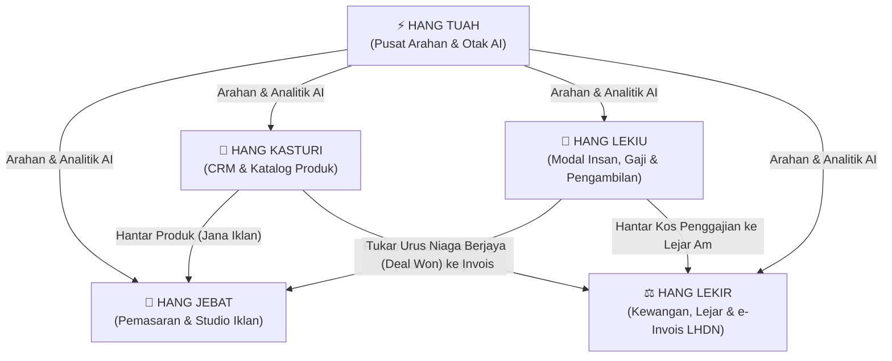
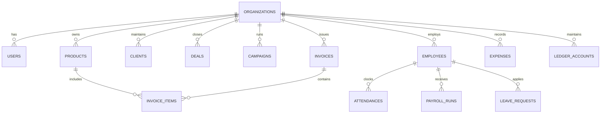

# Dokumen Keperluan Produk (PRD) — OpenKuasa OS

**Nama Projek:** OpenKuasa OS  
**Versi Dokumen:** 1.1 (Penyelarasan Teras 5 Bersaudara Melaka)  
**Status:** Aktif & Dalam Pembangunan  
**Tarikh Kemaskini:** Oktober 2026  
**Lesen:** AGPL-3.0 (Sumber Terbuka & Bebas Hos Kendiri)  
**Penyelenggara:** Inisiatif Komuniti PKS Malaysia  

---

## 1. Ringkasan Eksekutif & Visi Produk

### 1.1 Visi (Product Vision)
**OpenKuasa OS** ialah Sistem Operasi Perniagaan Berautonomi dan Berdaulat (*Sovereign AI-Native Business OS*) pertama khusus untuk Perusahaan Kecil dan Sederhana (PKS) di Malaysia. Ia menggabungkan pusat arahan AI, pengurusan perhubungan pelanggan (CRM), pemasaran & salinan iklan, modal insan & penggajian statutori Malaysia, serta perakaunan lejar am dan e-Invois LHDN ke dalam satu platform kendiri (*self-hosted*).

### 1.2 Masalah Semasa PKS Malaysia (Problem Statement)
PKS di Malaysia kini berdepan beberapa kekangan kritikal:
1. **Keletihan Langganan (*Subscription Fatigue*):** Syarikat terpaksa melanggan 5 hingga 8 perisian SaaS berasingan (HubSpot, Salesforce, Xero, AutoCount, Bukku, Kakitangan, JobStreet, ChatGPT Plus) dengan kos mencecah ribuan Ringgit setiap bulan dalam denominasi mata wang asing (USD).
2. **Ketiadaan Pematuhan Statutori Tempatan:** Kebanyakan perisian luar negara tidak menyokong undang-undang buruh dan percukaian Malaysia secara terbina (KWSP, PERKESO, EIS, PCB LHDN, SST 6%/8%, dan format MyInvois LHDN).
3. **Silo Data & Ketiadaan Kecerdasan Berpusat:** Data jualan, pekerja, kewangan, dan pemasaran tidak berhubung. Pengasas syarikat sukar mendapat gambaran eksekutif secara masa nyata.
4. **Isu Kedaulatan & Keselamatan Data (*Data Sovereignty*):** Data sulit perniagaan, gaji staf, dan penyata kewangan disimpan di pelayan awan pihak ketiga tanpa jaminan perlindungan tempatan.

### 1.3 Penyelesaian OpenKuasa OS
OpenKuasa OS menawarkan penyelesaian berdaulat:
- **Satu aplikasi bersepadu** untuk seluruh operasi syarikat.
- **Pematuhan undang-undang Malaysia** secara *out-of-the-box* (LHDN, KWSP, PERKESO).
- **Enjin AI Dwimodel (Tuah)** yang boleh beroperasi secara luar talian/tempatan menggunakan **Ollama** (menjamin privasi 100%) atau menggunakan **Google Gemini**.
- **Perlindungan Token & Anti-Salahguna**: Perlindungan ketat memastikan AI hanya bertindak sebagai Penasihat ERP Syarikat, bukan alat pengaturcaraan umum atau perkakasan penggodaman.

---

## 2. Rangka Kerja Persona 5 Bersaudara (Architecture Framework)

Seni bina OpenKuasa OS distrukturkan berasaskan lima pahlawan lagenda Melaka yang mewakili lima tunjang teras operasi perniagaan moden:



### Matriks Persona & Fungsi

| Pahlawan | Modul & Laluan | Peranan Utama | Entiti & Objek Data Teras |
| :--- | :--- | :--- | :--- |
| **⚡ Tuah** | Pusat Arahan AI (`/command`) | Business Brain, Analisis Eksekutif, Automasi Lintas Modul, Chatbot Syarikat Bersekatan Guardrails | `ai_configs`, `chat_sessions`, `chat_messages` |
| **📢 Jebat** | Pemasaran & Iklan (`/reach`, `/reach/studio`) | Pengurusan Kempen, Tangkapan Prospek (*Leads*), Studio Salinan Iklan AI (Meta, TikTok, WhatsApp, Google) | `campaigns`, `leads`, `ad_templates` |
| **🤝 Kasturi** | Jualan & CRM (`/crm`, `/crm/products`) | Saluran Urus Niaga (Kanban Deals), Direktori Syarikat/Pelanggan, **Katalog Produk & Servis** | `clients`, `deals`, `products`, `deal_activities` |
| **👥 Lekiu** | HR, Gaji & Staf (`/people`, `/people/hire`) | Kehadiran GPS/Clock-in, Cuti, Penggajian Statutori Malaysia (KWSP, PERKESO, EIS, PCB), **Pengambilan Staf (Hire / ATS)** | `employees`, `attendances`, `leave_requests`, `payroll_runs`, `job_postings`, `job_applications` |
| **⚖️ Lekir** | Kewangan & Cukai (`/finance`) | Invois Jualan, Sebut Harga, Perbelanjaan, Cukai SST (6%/8%), Pematuhan e-Invois LHDN, Lejar Berimbang | `invoices`, `invoice_items`, `expenses`, `ledger_accounts`, `journals`, `journal_entries` |

---

## 3. Spesifikasi Fungsian Terperinci (Functional Specifications)

### 3.1 ⚡ Modul Tuah (Pusat Arahan AI)
1. **Dwi-Penyedia Model AI:**
   - Menyokong sambungan tempatan **Ollama** (`http://127.0.0.1:11434`) untuk model sumber terbuka (Qwen 2.5, Llama 3, DeepSeek-R1).
   - Menyokong API awan **Google Gemini** (Gemini 1.5 Flash / Pro).
2. **Konteks Perniagaan Automatik (*System Context Injection*):**
   - Tuah menyuntik data semasa syarikat (prestasi jualan Kasturi, baki tunai & invois Lekir, statistik staf Lekiu, kempen Jebat) secara dinamik ke dalam prompt sistem.
3. **Kawalan Keselamatan & Anti-Salahguna Token (*Security Guardrails*):**
   - **Sekatan Skop Eksklusif:** Tuah hanya menjawab perkara berkaitan operasi syarikat yang dilog masuk.
   - **Pencegahan Penyalahgunaan:** Sebarang permintaan untuk menjana kod pengaturcaraan umum (Python, PHP, JavaScript luar konteks), penggodaman/ujian kerentanan (*vulnerability scanning*), atau kerja sekolah disekat serta-merta dengan mesej amaran standard.
   - **Pengasingan Penyewa (*Tenant Sandboxing*):** Pengguna syarikat A tidak boleh melihat atau menyoal data syarikat B. Hanya akaun **Superadmin** dibenarkan melihat statistik agregat seluruh sistem.
4. **Antara Muka Sembang Pintar:**
   - Perlindungan butang hantar (nyahdaya/disable sewaktu AI berfikir bagi mengelakkan panggilan berulang).
   - Autogulung (*auto-scroll*) ke mesej terbaharu.
   - Butang mula sesi sembang baharu yang membersihkan konteks sesi lama.

### 3.2 📢 Modul Jebat (Pemasaran & Studio Iklan)
1. **Pengurusan Kempen & Prospek:**
   - Pemantauan metrik belanjawan, kos perolehan (*CAC*), dan penukaran prospek (*conversion rate*).
   - Penjejakan sumber prospek (Meta Ads, Google Ads, TikTok, Rujukan Langsung).
2. **Jebat Ad Studio (Penjana Salinan Iklan Berasaskan AI):**
   - **Mod Produk (Kasturi Bridge):** Mengambil nama produk, harga, dan Nilai Jualan Unik (USP) dari Katalog Produk Kasturi dan menjana salinan iklan memukau.
   - **Mod Pengambilan Staf (Lekiu Bridge):** Mengambil maklumat jawatan kosong, syarat kelayakan, dan julat gaji dari Lekiu Hire dan menjana iklan pencarian bakat.
   - **Sokongan Format Platform Khusus:**
     - *Meta (Facebook/Instagram):* Format penceritaan masalah-penyelesaian (*PAS framework*), emosi, senarai faedah, dan seruan bertindak (*CTA*).
     - *TikTok:* Skrip video 15-30 saat merangkumi cangkuk visual 3 saat pertama (*Hook*), penceritaan isi, dan audio cadangan.
     - *WhatsApp Blast:* Mesej padat, mesra, berbutang pilihan jawapan dan pautan terus untuk prospek menekan mesej.
     - *Google Search Ads:* 3 tajuk utama (*Headlines* < 30 aksara) dan 2 huraian padat (*Descriptions* < 90 aksara) berfokus kata kunci carian tinggi.

### 3.3 🤝 Modul Kasturi (CRM, Jualan & Katalog Produk)
1. **Papan Kanban Urus Niaga (*Deals Pipeline*):**
   - Peringkat: Prospek Baharu &rarr; Rundingan &rarr; Sebut Harga &rarr; Ditutup Berjaya (*Won*) / Gagal (*Lost*).
   - Penukaran urus niaga berjaya terus kepada draf Invois Jualan dalam modul Lekir.
2. **Katalog Produk & Servis Bersepadu:**
   - Medan Data: SKU, Nama Produk, Kategori, Harga Jualan (RM), Harga Kos (RM), Kuantiti Stok, Status Aktif, dan USP (*Unique Selling Proposition*).
   - Butang Tindakan Pantas: Butang **⚡ Jana Iklan Jebat** terus memuatkan butiran produk ke dalam Jebat Ad Studio tanpa perlu salin-tampal manual.
3. **Direktori Perhubungan Pelanggan:**
   - Pengurusan rekod pelanggan individu dan akaun korporat (Sdn Bhd, Enterprise).

### 3.4 👥 Modul Lekiu (Modal Insan, Penggajian & Pengambilan Staf)
1. **Kehadiran & Cuti Staf:**
   - Punch card digital (Clock In / Clock Out) dengan rekod masa dan alamat IP.
   - Permohonan cuti tahunan, sakit, dan kecemasan dengan pengesahan baki automatik.
2. **Enjin Penggajian Statutori Malaysia:**
   - **KWSP (Kumpulan Wang Simpanan Pekerja):** Kadar pekerja 11%, kadar majikan 12% (gaji > RM5,000) atau 13% (gaji &le; RM5,000) mengikut Jadual Ketiga Akta KWSP 1991.
   - **PERKESO (SOCSO):** Skim Bencana Pekerjaan & Keilatan (Kategori 1) dan Skim Bencana Pekerjaan Sahaja (Kategori 2) mengikut siling gaji caruman terkini RM6,000.
   - **Sistem Insurans Pekerjaan (EIS):** Caruman majikan 0.2% dan pekerja 0.2% mengikut Akta Sistem Insurans Pekerjaan 2017.
   - **Potongan Cukai Bulanan (PCB):** Pengiraan potongan cukai pendapatan bulanan berpandukan jadual dan pelepasan asas LHDN.
3. **Pengambilan Staf & Pengurusan Calon (Lekiu Hire / ATS):**
   - Penerbitan iklan tawaran kerja syarikat.
   - Saluran penjejakan permohonan (*Applicant Tracking System*): Dimohon &rarr; Disaring &rarr; Temuduga &rarr; Tawaran &rarr; Ditolak.
   - Pintasan menjana iklan hebahan kekosongan jawatan menggunakan Jebat Ad Studio.

### 3.5 ⚖️ Modul Lekir (Kewangan, Perakaunan & e-Invois LHDN)
1. **Invois & Sebut Harga Jualan:**
   - Penjanaan invois rasmi dengan nombor siri berurutan.
   - Sokongan pengiraan cukai SST (6% bagi perkhidmatan asas, 8% bagi perkhidmatan terpilih mengikut garis panduan JKDM).
2. **Pematuhan e-Invois LHDN:**
   - Struktur data mematuhi garis panduan MyInvois LHDN (UBL 2.1 standard).
   - Penjejakan status: `Draft`, `Submitted`, `Valid`, `Rejected`, `Cancelled`.
   - Penyimpanan nombor UUID unik pengesahan LHDN dan penyediaan kod QR untuk salinan pelanggan.
3. **Perakaunan Lejar Am Berkembar (*Double-Entry Bookkeeping*):**
   - Catatan jurnal lejar mengikut prinsip perakaunan lazim: **Jumlah Debit MESTI Tepat Menyamai Jumlah Kredit**.
   - Pengurusan carta akaun: Aset, Liabiliti, Ekuiti, Hasil, dan Belanja.
   - Penyata Aliran Tunai dan Imbangan Duga secara automatik.

---

## 4. Seni Bina Teknikal & Pangkalan Data (Technical Architecture)

### 4.1 Tindanan Teknologi (Tech Stack)
- **Rangka Kerja Backend:** Laravel 13 (PHP 8.4+)
- **Pangkalan Data:** PostgreSQL 15+ (dengan integriti rujukan ketat dan pengindeksan UUID/Foreign Key)
- **Rangka Kerja Frontend:** Laravel Blade + Tailwind CSS v4 + Alpine.js (reka bentuk ringan, pantas, tanpa bebanan framework SPA berat)
- **Enjin AI:** Lapisan abstraksi tersuai (`AiConfigService`, `TuahAiService`) dengan integrasi cURL REST API kepada Ollama dan Google Gemini.

### 4.2 Seni Bina Multi-Tenant (Multi-Tenancy)
Setiap rekod data operasi perniagaan dikunci oleh lajur `organization_id`.
```sql
-- Pengasingan Tenant Contoh
SELECT * FROM products WHERE organization_id = 'tenant-uuid-123' AND is_active = true;
```
- **Global Scope:** Semua Model Eloquent (`Product`, `Deal`, `Employee`, `Invoice`, dll.) mengguna pakai trait pengasingan tenant automatik berasaskan sesi pengguna yang disahkan.
- **Peranan Pengguna:**
  - `superadmin`: Pentadbir pelayan/sistem (boleh melihat metrik global).
  - `admin`: Pengarah/Penyelia Syarikat (kuasa penuh dalam organisasinya).
  - `manager` & `staff`: Pekerja dengan kebenaran terhad mengikut modul masing-masing.

### 4.3 Rajah Entiti Data Utama (Entity Relationship)



---

## 5. Trak Pembangunan & Hala Tuju Masa Hadapan (Development Roadmap)

Dokumen ini menetapkan panduan rasmi bagi mengekalkan pembangunan pada landasan yang betul mengikut fasa berikut:

### Fasa 1: Teras 5 Bersaudara & Pematuhan Asas (SELESAI ✅)
- [x] Struktur asas seni bina 5 Bersaudara (Tuah, Jebat, Kasturi, Lekiu, Lekir).
- [x] Pelaksanaan multi-tenancy dan pengasingan data organisasi.
- [x] Enjin penggajian statutori Malaysia (KWSP 11/12/13%, PERKESO, EIS, PCB).
- [x] Pengiraan cukai SST (6% dan 8%) serta pengesahan lejar berimbang Debit = Kredit.
- [x] Modul Pengambilan Staf (Hire) disatukan sepenuhnya di bawah naungan Lekiu.
- [x] Pembangunan Katalog Produk & Servis di bawah Kasturi.
- [x] Pembangunan Jebat Ad Studio untuk salinan iklan pelbagai format (Meta, TikTok, WhatsApp, Google).
- [x] Sekatan keselamatan ketat (*Strict Guardrails*) Tuah AI untuk mengelakkan pembaziran token dan penggodaman.
- [x] Sokongan prapapar model AI tempatan (Ollama) dan pelayan awan (Gemini).
- [x] 126 ujian automasi PHPUnit lulus dengan 903 pengesahan (*assertions*).

---

### Fasa 2: Integrasi Mendalam & Automasi Operasi (FOKUS SEGERA 🎯)

#### Fasa 2.1 — Integrasi Penuh API MyInvois LHDN (Lekir)
*Objektif:* Membolehkan penghantaran terus e-Invois dari Lekir ke pelayan MyInvois LHDN tanpa perantara manual.
- **Keperluan:**
  - Pengesahan API melalui protokol OAuth2 Client Credentials LHDN (Sandbox & Production).
  - Penjanaan dokumen digital format JSON / XML mengikut skema e-Invois LHDN versi 2.3.
  - Penerimaan dan pemfailan automatik kod pengesahan UUID serta pautan kod QR LHDN.
  - Butang semakan status penghantaran secara berkala (*Status Polling / Webhook listener*).

#### Fasa 2.2 — Tolakan Inventori Automatik (Kasturi & Lekir)
*Objektif:* Mengurangkan kuantiti stok produk secara automatik apabila invois jualan disahkan.
- **Keperluan:**
  - Apabila status Invois jualan bertukar dari `draft` ke `posted` / `paid`, kuantiti stok dalam `products.stock_quantity` dipotong secara atomik.
  - Log audit pergerakan stok (*Stock Ledger Movement*) direkodkan.
  - Peringatan stok rendah dipaparkan pada papan pemuka Kasturi dan dimaklumkan oleh Tuah AI.

#### Fasa 2.3 — Gerbang Penghantaran WhatsApp Pintar (Jebat & Lekir)
*Objektif:* Menghubungkan sistem terus kepada telefon pelanggan untuk notifikasi jualan dan invois.
- **Keperluan:**
  - Penghantaran invois PDF Lekir dan pautan bayaran pantas melalui WhatsApp Business API / Webhook.
  - Pengesahan prospek baharu Jebat terus menghantar mesej selamat datang WhatsApp.

#### Fasa 2.4 — Portal Layan Diri Staf / ESS Mudah Alih (Lekiu)
*Objektif:* Memudahkan staf mengurus kehadiran dan dokumen gaji dari telefon pintar mereka.
- **Keperluan:**
  - Paparan mesra mudah alih untuk staf melakukan *Clock-In/Clock-Out* berasaskan geolokasi GPS syarikat.
  - Muat turun slip gaji bulanan (Payslip PDF) yang mengandungi butiran potongan statutori rasmi.
  - Semakan baki cuti tahunan dan status permohonan secara terus.

---

### Fasa 3: Kecerdasan Lanjutan & Ekosistem Terbuka (JANGKA PANJANG 🚀)

#### Fasa 3.1 — Penjanaan Laporan Audit & Cukai Automatik Tuah AI
- Tuah berupaya merumuskan penyata Untung & Rugi (P&L), Lembaran Imbangan, dan draf Borang Cukai LHDN (Borang B / Borang e-C) untuk semakan juruaudit bertauliah syarikat.
- Pengesanan anomali perbelanjaan (*Expense fraud detection*) secara pintar.

#### Fasa 3.2 — Pengurusan Pelbagai Cawangan & Gudang (Multi-Warehouse)
- Sokongan pemindahan stok antara cawangan syarikat di bawah katalog Kasturi.
- Penjejakan kos penghantaran dan logistik tempatan (J&T, NinjaVan, PosLaju API).

#### Fasa 3.3 — Pasaran Plugin Komuniti PKS Malaysia
- Membuka seni bina pemalam (*Plugin Architecture*) yang membolehkan pembangun tempatan membina integrasi bank tempatan (FPX, DuitNow QR, Maybank, CIMB, Bank Islam) dan kurier secara sukarela di bawah payung lesen AGPL.

---

## 6. Piawaian Kualiti & Kriteria Penerimaan (Acceptance Criteria)

Setiap penambahan kod atau modul baharu pada masa hadapan **wajib** mematuhi piawaian berikut sebelum digabungkan ke cawangan utama (*main*):
1. **Pematuhan Ujian Unit & Integrasi:**
   - Semua ujian automasi PHPUnit (`php artisan test`) mesti melepasi 100% tanpa sebarang ralat atau amaran rosak.
2. **Kedaulatan & Pengasingan Data:**
   - Tiada data daripada organisasi berasingan dibenarkan bocor (*strict multi-tenant isolation*).
3. **Pengekalan Falsafah 5 Bersaudara:**
   - Sebarang fungsi baharu mesti dikategorikan secara logik di bawah salah seorang pahlawan (Tuah, Jebat, Kasturi, Lekiu, atau Lekir) tanpa menambah entiti nama yang memecahbelahkan konsistensi identiti sistem.
4. **Kecekapan Sumber Sistem:**
   - Penggunaan pangkalan data PostgreSQL berindeks rapi bagi membolehkan sistem beroperasi pantas pada pelayan VPS mampu milik (contoh: 2 vCPU, 4GB RAM).
5. **Integriti Dokumentasi:**
   - Setiap perubahan skema pangkalan data atau API wajib didokumenkan dalam `PRD.md` dan `README.md`.
