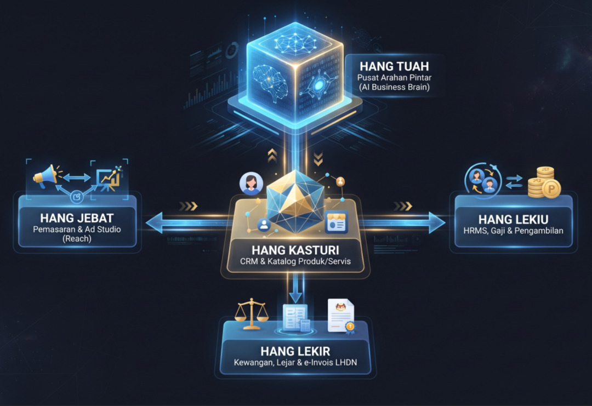

# KerjaAI (Laravel 13 + PostgreSQL)

**Sistem Operasi Perniagaan AI Sumber Terbuka Pertama untuk PKS Malaysia.**  
Satu aplikasi *self-hostable* merangkumi CRM, Pemasaran, HR, Pengambilan Staf, dan Perakaunan dengan Pusat Arahan AI pintar — menggantikan langganan perisian SaaS berasingan yang mahal.

> [!NOTE]
> **Pemberitahuan Asal Usul Projek (*Fork Disclosure*):**  
> **KerjaAI** adalah projek sumber terbuka berasaskan komuniti (*crowd-sourced*), yang merupakan **fork** dan asalnya diasaskan daripada projek [OpenKuasa (OpenKuasaOS)](https://github.com/engkuhelmy/OpenKuasaOS). Pembangunan diteruskan secara telus dan aktif oleh komuniti serta penyumbang sukarela.

Dikuasakan oleh **Laravel 13**, **PostgreSQL**, dan **Tailwind CSS v4** Blade templates.

**Percuma untuk dihos sendiri, selamanya.** Dilesenkan di bawah [AGPL-3.0](LICENSE).

---

## 🏛️ Seni Bina 5 Bersaudara (The 5 Brothers Architecture)

KerjaAI disusun mengikut falsafah pahlawan 5 Bersaudara Melaka yang mewakili lima tunjang teras operasi perniagaan moden:

<p align="center">
  
</p>

| Modul | Nama Pahlawan | Peranan & Fungsi Utama | Laluan Web |
| --- | --- | --- | --- |
| **Tuah** | Pusat Arahan AI | **Business Brain**: Pengendalian AI eksekutif (Ollama tempatan / Gemini awan), analisis data merentas sistem, sembang pintar syarikat dengan sekatan ketat perlindungan token & pengasingan tenant. | `/command` |
| **Jebat** | Pemasaran & Studio Iklan | **Reach & Copywriting**: Pengurusan kempen pemasaran (Meta, Google, TikTok), tangkapan prospek (*leads*), dan **Jebat Ad Studio** untuk menjana salinan iklan produk dan jawatan kosong secara automatik mengikut platform. | `/reach` |
| **Kasturi** | Jualan & Katalog Produk | **CRM & Catalog**: Pengurusan saluran jualan (Kanban Deals), pangkalan data pelanggan/syarikat, serta **Katalog Produk & Servis** (harga, kos, stok, USP & pintasan jana iklan terus ke Jebat). | `/crm` & `/crm/products` |
| **Lekiu** | Modal Insan & Pengambilan | **People & Hire**: Rekod kehadiran (Clock In/Out), permohonan cuti, enjin penggajian statutori Malaysia (KWSP 11%/12%/13%, PERKESO, EIS, PCB), serta **Sistem Pengambilan Staf (Hire / ATS)** untuk iklan jawatan & resume. | `/people` & `/people/hire` |
| **Lekir** | Kewangan & Percukaian | **Finance & Treasury**: Invois jualan, sebut harga, perbelanjaan, pengiraan cukai SST (6%/8%), persediaan pematuhan e-Invois LHDN, lejar am berimbang (Debit = Kredit), akaun bank & aliran tunai. | `/finance` |

---

## ⚡ Ciri-Ciri Utama (Key Features)

### 1. ⚡ Tuah AI Command Center
- **Dwi-Enjin AI:** Boleh dikonfigurasi menggunakan pelayan model AI tempatan (**Ollama** - contoh: Qwen 2.5, Llama 3, DeepSeek) atau API awan (**Google Gemini**).
- **Perlindungan Token & Anti-Salahguna (*Strict Guardrails*):** Enjin AI dikunci secara eksklusif untuk menjawab operasi perniagaan syarikat yang sedang log masuk. Sebarang cubaan meminta kod pengaturcaraan umum, penggodaman laman web, atau soalan luar topik disekat serta-merta bagi menjimatkan token dan mengelak salah guna.
- **Pengasingan Multi-Tenant:** Data syarikat terasing rapi mengikut organisasi; hanya akaun Superadmin dibenarkan melihat paparan agregat seluruh sistem.

### 2. 📢 Jebat Ad Studio & Pemasaran
- **Penjana Iklan Pelbagai Platform:** Menjana salinan iklan berkesan khusus mengikut format Facebook/Instagram (panjang & beremosi), TikTok (skrip video & cangkuk perhatian), WhatsApp Blast (ringkas dengan butang CTA), dan Google Ads (tajuk padat & huraian berfokus kata kunci).
- **Integrasi Bersilang Modul:** Boleh menjana iklan terus daripada Katalog Produk Kasturi atau Iklan Jawatan Lekiu dengan satu klik.
- **Saluran Prospek (*Leads*):** Pengurusan dan penjejakan status prospek pelanggan baharu.

### 3. 🤝 Kasturi CRM & Katalog Produk
- **Katalog Produk & Perkhidmatan:** Pengurusan SKU, harga jualan, harga kos, kuantiti stok, dan Nilai Jualan Unik (USP).
- **Papan Jualan Kanban:** Penjejakan urus niaga mengikut peringkat (Prospek, Rundingan, Ditutup Berjaya / Gagal).
- **Direktori Pelanggan:** Pangkalan data maklumat syarikat dan perhubungan perniagaan.

### 4. 👥 Lekiu HRMS & Pengambilan Staf (Hire)
- **Enjin Statutori Malaysia:** Pengiraan automatik caruman KWSP (kadar majikan 12%/13%, kadar pekerja 11%), PERKESO (Kategori 1 & 2), EIS, dan Potongan Cukai Bulanan (PCB LHDN).
- **Pengurusan Kehadiran & Cuti:** Rekod masa bekerja, semakan baki cuti tahunan, dan kelulusan cuti oleh pengurus.
- **Pengambilan Staf (Hire / ATS):** Paparan iklan kekosongan jawatan syarikat, penjejakan saluran resume pemohon, dan penjanaan iklan pencarian bakat menggunakan Jebat Ad Studio.

### 5. ⚖️ Lekir Kewangan & e-Invois LHDN
- **Pematuhan Cukai Tempatan:** Sokongan pengiraan cukai SST (6% dan 8%) serta invois jualan dan sebut harga rasmi.
- **Persediaan e-Invois LHDN:** Struktur data dan status e-invois bersedia untuk penghantaran ke portal MyInvois LHDN.
- **Perakaunan Lejar Berkembar:** Catatan jurnal lejar am berimbang (*Debit = Kredit*) dan rekod perbelanjaan syarikat.

---

## 🛠️ Keperluan Sistem (System Requirements)

- **PHP 8.3+** (disyorkan PHP 8.4) bersama sambungan: `pdo_pgsql`, `pgsql`, `mbstring`, `bcmath`, `curl`, `dom`, `tokenizer`, `xml`.
- **PostgreSQL 15+**
- **Composer 2.x**
- **Node.js 20+** & **npm** (untuk kompilasi Vite & Tailwind CSS v4)
- *(Pilihan)* **Ollama** jika ingin menjalankan model AI secara kendiri/luar talian.

---

## 🚀 Panduan Pemasangan Pantas (Quickstart)

### 1. Klon Repositori & Pasang Kebergantungan
```bash
git clone https://github.com/engkuhelmy/OpenKuasaOS.git
cd OpenKuasaOS

# Pasang pakej PHP
composer install

# Pasang aset frontend & kompilasi
npm install
npm run build
```

### 2. Konfigurasi Fail Persekitaran (`.env`)
Salin templat persekitaran dan jana kunci aplikasi:
```bash
cp .env.example .env
php artisan key:generate
```

Tetapkan sambungan PostgreSQL di dalam fail `.env`:
```env
DB_CONNECTION=pgsql
DB_HOST=127.0.0.1
DB_PORT=5432
DB_DATABASE=openkuasa
DB_USERNAME=postgres
DB_PASSWORD=kata_laluan_anda
```

### 3. Migrasi Skema & Masukkan Data Demo
Jalankan migrasi jadual multi-tenant dan data syarikat contoh (*Rimba Ventures Sdn Bhd*):
```bash
php artisan migrate:fresh --seed
```

**Maklumat Log Masuk Demo:**
- **Penyelia Syarikat (Admin):** `admin@openkuasa.my` | Kata Laluan: `password`
- **Superadmin Sistem:** `superadmin@openkuasa.my` | Kata Laluan: `password`

### 4. Mulakan Pelayan
```bash
php artisan serve
```
Buka pelayar web anda di: `http://localhost:8000`.

---

## 🧪 Ujian Automasi & Jaminan Kualiti (Test Suite)

Sistem ini disokong oleh ujian unit & integrasi PHPUnit yang menyeluruh untuk memastikan ketepatan statutori dan kestabilan sistem:

```bash
php artisan test
```

Ujian merangkumi:
- Formula caruman statutori KWSP, PERKESO, EIS & PCB LHDN (`PayrollCalculationTest`).
- Pengiraan dan pembundaran cukai SST 6% & 8% (`SstCalculationTest`).
- Pengesahan lejar am berimbang Debit = Kredit (`BendaharaPostingValidationTest` / Lekir).
- Kitaran penuh invois jualan & perbelanjaan (`InvoiceLifecycleTest`).
- Pengasingan data multi-tenant mengikut organisasi (`MultiTenantIsolationTest`).
- Logik kelulusan dan kuota cuti staf (`LeaveApprovalTest`).
- Perlindungan keselamatan prompt & guardrails Tuah AI (`TuahAiEngineTest`).
- Kesemua paparan modul web & navigasi 5 Bersaudara (`WebModuleViewsTest`).

---

## 🗺️ Hala Tuju Pembangunan (Roadmap)

Rujuk fail [PRD.md](PRD.md) untuk dokumen keperluan produk penuh, seni bina teknikal, dan jadual pembangunan terperinci bagi fasa seterusnya (termasuk integrasi terus API MyInvois LHDN, penolakan stok automatik, dan automasi WhatsApp).

---

## 📄 Lesen

Dilesenkan di bawah [AGPL-3.0](LICENSE). Hak cipta terpelihara komuniti KerjaAI & OpenKuasa.
